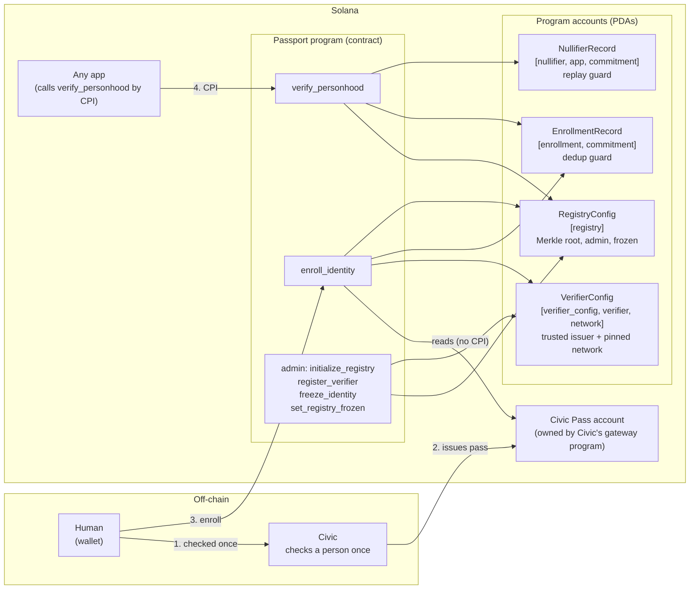
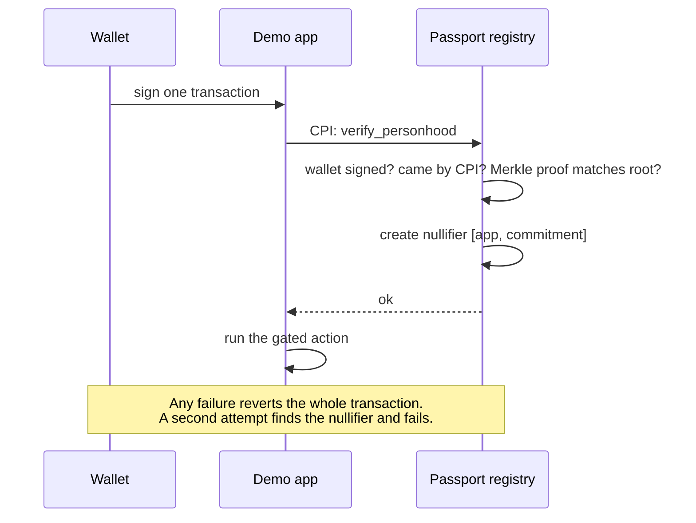
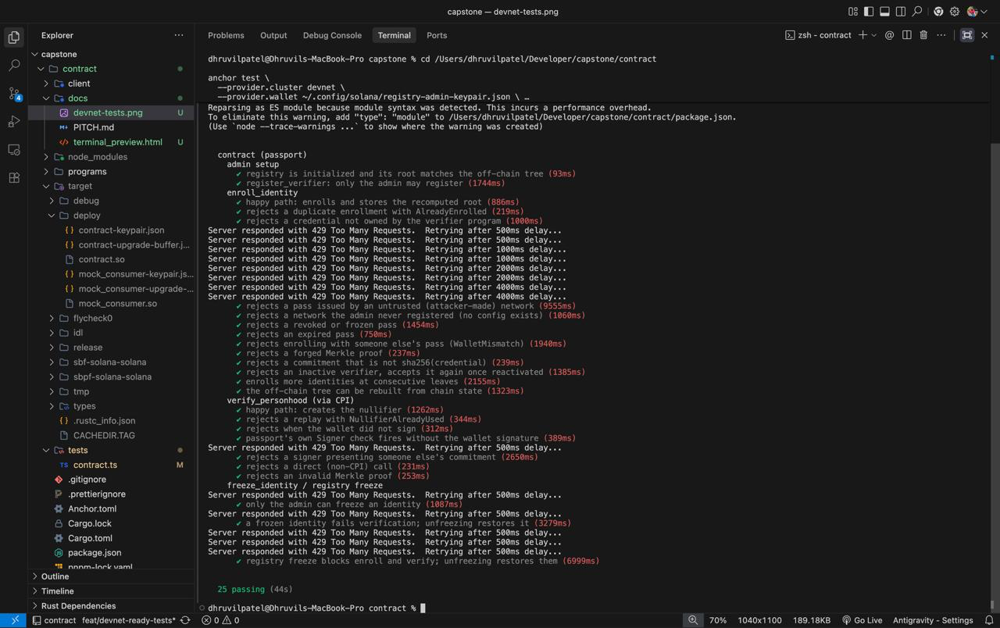

# Solana Passport

**One human, one identity, replay-proof, for any Solana app.**

A privacy-conscious proof-of-personhood registry built with Anchor. A person proves once (via a trusted
credential such as Civic Pass) that they are a real human and joins the registry. Any app can then ask,
in the same transaction, "is this wallet a real person, and have they used my app before?" and get a
yes or no. The registry never stores identity documents.

Capstone project, Turbine cohort. Team: Fantastic 3.

## Devnet deployment

| Program | Devnet Program ID |
|---|---|
| `contract` (the registry) | [`6yH5EwvxmJbKoVgYPni6NMaLwNChgen23CkF9omvYbDE`](https://explorer.solana.com/address/6yH5EwvxmJbKoVgYPni6NMaLwNChgen23CkF9omvYbDE?cluster=devnet) |
| `mock_consumer` (demo app + demo pass issuer) | [`7ZBun553WhQd3iruZoxvDPj46uDjY4bsZZGqa2Aw7i68`](https://explorer.solana.com/address/7ZBun553WhQd3iruZoxvDPj46uDjY4bsZZGqa2Aw7i68?cluster=devnet) |

## Problem and solution

Wallets are free, so one person can look like a thousand: airdrops get farmed, votes get skewed. The usual
fix, collecting ID documents, makes every app a store of sensitive data. Apps only need one answer.

Solana Passport gives them that answer:

1. A trusted checker (Civic Pass) confirms a person once, off-chain, and issues a pass to their wallet.
2. The registry reads that pass on-chain and adds a hash of it to a Merkle tree: **one entry per pass, ever**.
3. An app asks the registry to verify a wallet by CPI. The registry confirms membership and stamps the
   person for that app (a **nullifier**), so **the same person cannot repeat the action in the same app**.

## Architecture

### System overview



### Verify, in one transaction



### Enroll: five gates

`enroll_identity` rejects the transaction unless **all** of these hold:

1. **Owner:** the pass account is owned by the trusted verifier program.
2. **Network:** it was issued by the one network pinned in `VerifierConfig`. (Anyone can create their own
   gatekeeper network under the same program, so an owner check alone would accept a self-minted pass.)
3. **Status:** it is active (not frozen or revoked) and not expired.
4. **Wallet:** it was issued to the wallet that signs.
5. **New:** no enrollment exists for this pass (`commitment = sha256(pass address)`, derived by the program,
   never chosen by the client; the enrollment PDA is seeded by it).

Then the program proves the next Merkle slot was empty, inserts the commitment, and stores the new root.

### Merkle tree

Only the 32-byte root and the next free leaf index live on-chain. The client keeps the tree (rebuilt from
`EnrollmentRecord`s) and supplies sibling hashes; the program recomputes the root and compares. Depth 20
holds 1,048,576 identities.

## Instructions

| Instruction | Who | What |
|---|---|---|
| `initialize_registry` | admin | creates the registry with the empty-tree Merkle root |
| `register_verifier(verifier, network, is_active)` | admin | trust a verifier program **and pin one issuing network** (or deactivate it) |
| `enroll_identity(commitment, proof)` | wallet | the five gates above, then insert the leaf and store the new root |
| `verify_personhood(commitment, consumer, proof)` | wallet, **via CPI** | wallet must sign; Merkle proof must match; creates the per-app nullifier or fails with `NullifierAlreadyUsed` |
| `freeze_identity(commitment, frozen)` | admin | freeze/unfreeze one enrollment |
| `set_registry_frozen(frozen)` | admin | global kill switch for enroll + verify |

## Tests

30 tests: 25 integration tests (mocha, `tests/contract.ts`) and 5 Rust unit tests (Merkle tree and Civic
parser, including **real Civic pass accounts read from devnet**).

**Devnet test run (passing):**



What the integration tests cover: admin setup and authorisation; enroll (happy path, duplicate, wrong owner,
untrusted network, revoked/frozen/expired pass, someone else's pass, forged proof, wrong commitment,
deactivated verifier); verify via CPI (happy path, replay, missing signature, someone else's commitment,
direct non-CPI call, invalid proof); per-identity and registry-wide freezes.

### Run the tests

The suite is idempotent: if the registry already exists it reuses it and rebuilds the Merkle tree from
chain state, so it runs against devnet's existing data. It needs the **registry admin** wallet, because it
exercises the admin instructions.

```bash
pnpm install
anchor build

# local validator (starts and stops its own)
anchor test --skip-build

# devnet: use the wallet that is the registry admin (check with: pnpm exec ts-node scripts/..., or the Admin tab)
export ANCHOR_WALLET=/path/to/registry-admin-keypair.json
anchor test --provider.cluster devnet --skip-local-validator --skip-build
# the public devnet RPC rate-limits; a dedicated RPC URL works too:
#   --provider.cluster https://your-rpc-url
```

Rust unit tests: `cargo test -p contract --lib`.

### Demo script (end to end)

```bash
ANCHOR_PROVIDER_URL=https://api.devnet.solana.com ANCHOR_WALLET=~/.config/solana/id.json \
  pnpm exec ts-node -P tsconfig.json client/demo.ts
```
Admin setup, enroll, a gated app action by CPI, and the replay being refused.

## Upgrading the devnet deployment (upgrade-authority wallet)

```bash
anchor build && anchor deploy --provider.cluster devnet
```
Existing registry, enrollments and nullifiers stay valid across the upgrade (rehearsed locally with legacy
state). Then, as the registry admin, trust the issuers (frontend Admin tab, **Quick setup**, or
`register_verifier`).

## Credential: Civic Pass

`enroll_identity` reads a Civic Pass ("gateway token"), an account owned by Civic's gateway program
(`gatem74V238djXdzWnJf94Wo1DcnuGkfijbf3AuBhfs`, the same id on devnet and mainnet). The parser
(`programs/contract/src/credential.rs`) mirrors Civic's borsh layout and is tested against real devnet pass
accounts. Reclaim Protocol was evaluated first, but its Solana program is stateless (it verifies a proof
inside the transaction and leaves no credential account), so it does not fit an account-read design.

**Demo issuer.** Civic passes are issued inside apps that integrate Civic (we found no public sign-up
page), so for tests and demos `mock_consumer.issue_demo_pass` writes an account in Civic's exact layout. It
exercises the whole registry but is **not** a real identity check. The real-pass path (`REAL_CIVIC=1` in the
demo, "My Civic Pass" in the frontend) has not been run end to end with a live pass.

## Repository layout

- `programs/contract`: the registry program
- `programs/mock-consumer`: demo app that gates an action behind `verify_personhood`, plus the demo pass issuer
- `client/passport.ts`: sparse Merkle tree and PDA helpers; `client/demo.ts`: end-to-end demo
- `tests/contract.ts`: integration tests
- Frontend (separate repo): https://github.com/FantasticThreeBros/frontend

## Known limitations

- **Pseudonymous, not anonymous.** No zero-knowledge proofs yet. The wallet-to-commitment link is public and
  the commitment is the same across apps, so apps can link a user; the per-app nullifier only stops replay
  within one app. Zero-knowledge membership proofs are the next step.
- Uniqueness relies on the credential issuer (Civic's Uniqueness Pass is one user per wallet).
- A pass is checked at enroll time only; later revocation does not remove an enrollment.
- The Merkle tree is kept off-chain. Concurrent enrolls can invalidate each other's proofs (the client
  retries). Production would use SPL account compression.
- `verify_personhood` attributes a call to the top-level program, so a nested CPI chain is attributed to the
  outermost program.
